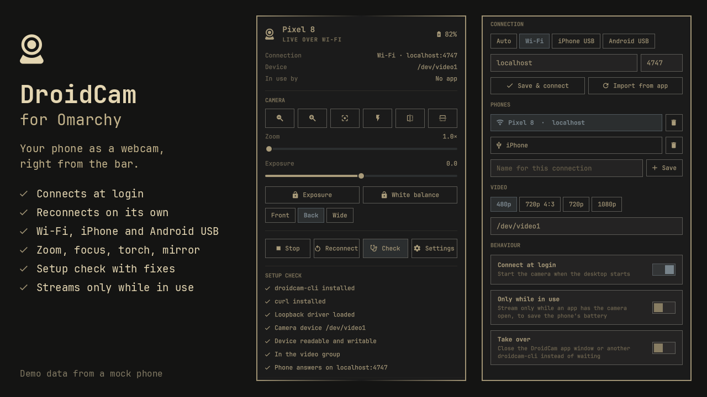

# DroidCam for Omarchy

Use your phone as a webcam with [DroidCam](https://droidcam.app), straight from the
Omarchy bar.



- **Connects at login** over Wi-Fi or USB (iPhone and Android), and **reconnects** by
  itself when the stream drops or the phone comes back.
- **Camera controls** in the popup: zoom, autofocus, torch, mirror and flip. With
  DroidCam Pro on the phone you also get a zoom slider, exposure, exposure and
  white-balance locks, and front/back camera switching.
- **Phone status**: name and battery.
- **Setup check**: finds what is missing (client, driver, permissions, usbmuxd, adb,
  network) and says how to fix it.
- **Only while in use** (optional): streams only while an app has the camera open, to
  save the phone's battery.
- **Saved phones**: switch between phones or connections in one click.
- **Lightweight**: no polling while idle. The video runs in `droidcam-cli`, outside the
  shell; the plugin only watches it.

## Requirements

| Needed for | What |
|---|---|
| Everything | The DroidCam Linux client (`droidcam-cli`) 2.x, `curl`, `bash` |
| A camera device | The `v4l2loopback-dc` kernel module (installed with the DroidCam client), or plain `v4l2loopback` |
| iPhone over USB | `usbmuxd` (and `libimobiledevice`), the computer trusted on the phone |
| Android over USB | `adb` (`android-tools`), USB debugging allowed on the phone |
| Preview (optional) | `ffmpeg` |
| Audio (optional) | the `snd-aloop` kernel module |
| Better device detection (optional) | `v4l-utils` (`v4l2-ctl`) |
| Used when present | `setpriv`, `stdbuf`, `ss`, `udevadm`, `ip` (util-linux, coreutils, iproute2, systemd: on every Omarchy install) |

On Arch, CachyOS and Omarchy, the `droidcam` package from the AUR brings the client
and the `v4l2loopback-dc` driver. On other distributions use the installer from
[droidcam.app/linux](https://droidcam.app/linux/). The [install guide](docs/INSTALL.md)
covers loading the driver, permissions, and the USB extras step by step.

## Install

```bash
omarchy plugin add https://github.com/saurasanchezpablo/oma-cam.git --enable
```

The icon appears in the right section of the bar
(`omarchy bar move io.github.saurasanchezpablo.droidcam --section center` moves it).

Update with `omarchy plugin update io.github.saurasanchezpablo.droidcam`.

## Remove

```bash
omarchy plugin remove io.github.saurasanchezpablo.droidcam
```

This stops the stream, removes the icon and its settings, and deletes the plugin
folder. The DroidCam client and driver stay installed; remove them separately if you
no longer need them.

## Setup

1. Open the DroidCam app on the phone. It shows the Wi-Fi IP and port.
2. Click the bar icon, open **Settings**, enter the address, and click **Save &
   connect**. If you already use the DroidCam desktop app, **Import from app** reads
   its settings.
3. For USB, plug the phone in. In **Auto** mode the plugin prefers USB when a phone
   is attached, and Wi-Fi otherwise.

The DroidCam app accepts one client at a time. If the DroidCam desktop window (or
another `droidcam-cli`) is streaming from the same phone, the plugin waits. Turn on
**Take over** to close it instead.

## Using it

| Bar icon | |
|---|---|
| Left click | Details, controls and settings |
| Middle click | Connect or disconnect |
| Right click | Reconnect |

The icon is dimmed while the camera is not streaming, pulses while connecting, and
turns to a warning when something needs setting up.

Popup keys: `c` connect/disconnect, `r` reconnect, `+`/`-` zoom, `a` autofocus, `l`
torch, `m` mirror, `d` setup check, `s` settings, `Esc` close.

### Commands

```bash
ID=io.github.saurasanchezpablo.droidcam
omarchy-shell shell toggle $ID        # open or close the popup
omarchy-shell $ID status              # state as JSON
omarchy-shell $ID connect             # also: disconnect, reconnect, toggle
omarchy-shell $ID control torch       # zoomIn, zoomOut, focus, torch, mirror, flip
omarchy-shell $ID set zoom 2.5        # DroidCam Pro: zoom, ev, camera <index>
omarchy-shell $ID doctor              # run the setup check (results in status)
omarchy-shell $ID configure '{"mode":"wifi","host":"192.168.1.50","port":4747}'
```

### A keybinding

In `~/.config/hypr/bindings.lua`:

```lua
o.bind("SUPER + SHIFT + W", "DroidCam", "omarchy-shell shell toggle io.github.saurasanchezpablo.droidcam")
o.bind("SUPER + SHIFT + ALT + W", "DroidCam torch", "omarchy-shell io.github.saurasanchezpablo.droidcam control torch")
```

### Omarchy menu entries

In `~/.config/omarchy/extensions/omarchy-menu.jsonc`:

```jsonc
"trigger.droidcam": {"icon":"󰖠","label":"DroidCam"},
"trigger.droidcam.toggle": {"icon":"󰖠","label":"Connect / disconnect","checked":"omarchy-shell io.github.saurasanchezpablo.droidcam status | grep -q '\"state\":\"live\"'","action":"omarchy-shell io.github.saurasanchezpablo.droidcam toggle"},
"trigger.droidcam.reconnect": {"icon":"󰜉","label":"Reconnect","action":"omarchy-shell io.github.saurasanchezpablo.droidcam reconnect"},
"trigger.droidcam.torch": {"icon":"󰉁","label":"Torch","action":"omarchy-shell io.github.saurasanchezpablo.droidcam control torch"},
"trigger.droidcam.open": {"icon":"󰒓","label":"Open panel","action":"omarchy-shell shell toggle io.github.saurasanchezpablo.droidcam"},
```

## Settings

All settings are in the popup. They are stored in the widget's entry in
`~/.config/omarchy/shell.json`.

| Setting | Default | |
|---|---|---|
| `mode` | `auto` | `auto`, `wifi`, `ios` (iPhone USB), `adb` (Android USB) |
| `host`, `port` | `""`, `4747` | The phone's Wi-Fi address |
| `device` | `""` | Loopback device; automatic picks the DroidCam driver's |
| `size` | `640x480` | Plain v4l2loopback only; the DroidCam driver sets its own |
| `hflip`, `vflip` | `false` | Mirror and vertical flip |
| `audio` | `false` | Phone as a microphone (needs `snd-aloop`) |
| `autoConnect` | `true` | Connect when the desktop starts |
| `takeOver` | `false` | Close another DroidCam client using the same phone |
| `onDemand`, `idleStop` | `false`, `60` | Stream only while in use; seconds to keep going after the last app closes the camera |
| `notify` | `true` | Connected, disconnected, setup problems |
| `hideWhenOff` | `false` | Hide the icon while not streaming |
| `preview` | `false` | Picture in the popup, every 2 s while it is open (needs ffmpeg and `XDG_RUNTIME_DIR`); never kept after the popup closes |
| `cliPath` | `""` | Path to `droidcam-cli` if it is not on `PATH` |

## Troubleshooting

Start with **Check** in the popup, or `omarchy-shell io.github.saurasanchezpablo.droidcam doctor`
followed by `status`.

- **Phone not reachable**: the app must be open, and the phone on the same network.
  Some routers isolate Wi-Fi clients from each other.
- **Phone refused the stream**: another client is streaming from it, or the app is in
  the background (iOS stops it).
- **Camera device missing after a kernel update**: the DKMS module needs rebuilding;
  reinstall the DroidCam driver package.
- **Only while in use never starts**: the plugin sees the apps of your own user only,
  and an app has to open the camera device to be noticed.

See [docs/STATES.md](docs/STATES.md) for every state and [docs/ARCHITECTURE.md](docs/ARCHITECTURE.md)
for how it works.

## License

MIT. DroidCam is a product of Dev47Apps; this plugin is not affiliated with them.
